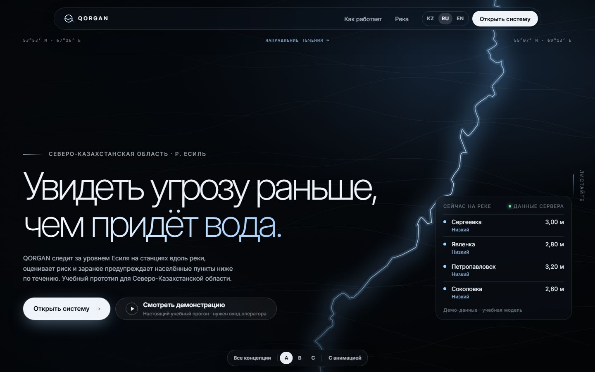
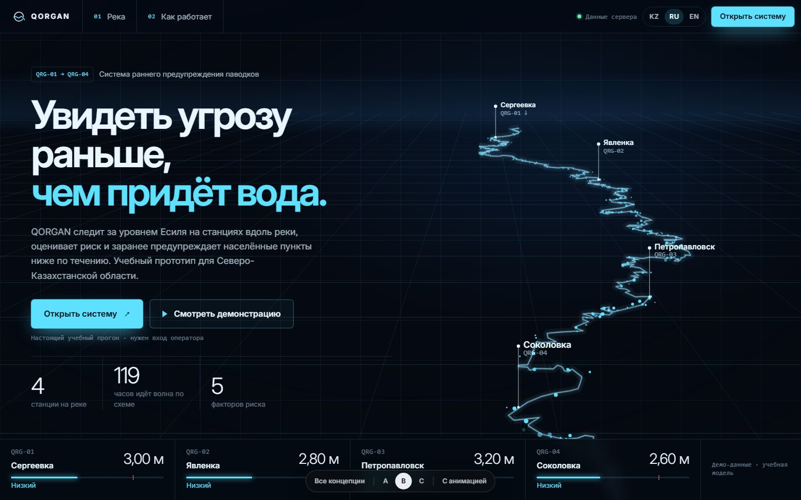
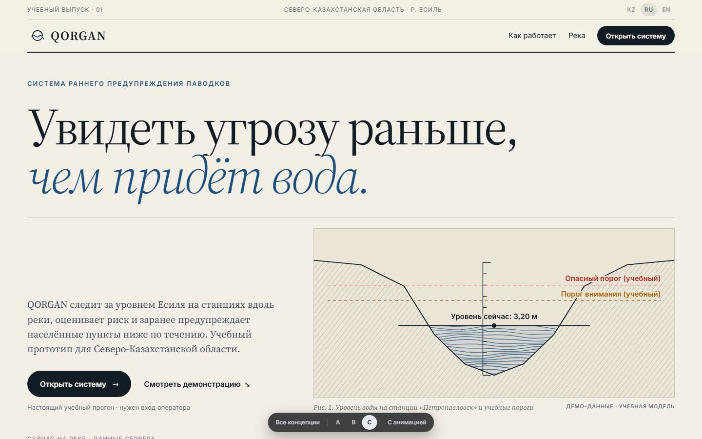

# QORGAN Eclipse Cinematic — три концепции главной страницы

> **Решение принято (2026-10-29): выбрана B — HYDRO FUTURE, анимированная версия.** A и C отклонены. Страница выбора
> `#/concepts`, панель прототипа и переключатель «С анимацией / Без анимации» убраны; старые адреса `#/concepts…`
> ведут на главную. Код A и C удалён из сборки и остаётся в истории Git (коммит `ad56e5b`). Финальная страница —
> [HYDRO_FUTURE_FINAL.md](HYDRO_FUTURE_FINAL.md). Ниже — исходное описание этапа выбора (архив); инструкции «Как
> посмотреть» больше не действуют.

Этап выбора направления. Готовы **первые экраны** трёх концепций и по два раздела ниже («Как работает», «Река»).
Полная главная страница (5 разделов) будет сделана только для выбранной концепции.

Слоган: **«Увидеть угрозу раньше, чем придёт вода»** · «Су жетпей тұрып, қауіпті ерте көру» · «See the threat before
the water arrives». Это слоган учебного продукта, а не обещание точности прогноза. Казахский вариант нужно показать
носителю языка.

## Как посмотреть

1. В папке `D:\QASH\resources\HackTons\QORGAN\.claude\worktrees\eclipse` выполнить `npm run dev`.
2. Открыть http://localhost:5173/#/concepts — страница выбора с тремя карточками.
3. Прототипы: `#/concepts/a`, `#/concepts/b`, `#/concepts/c`. Внизу — панель прототипа: «Все концепции», A / B / C и
   «С анимацией» / «Без анимации».
4. Если на компьютере в Windows выключены эффекты анимации, прототип откроется статичным — нажмите **«С анимацией»**.
5. Чтобы увидеть живые данные (риск, уровни, угроза сверху), нажмите **«Смотреть демонстрацию»**: войдите как
   оператор (учётная запись из `.env`) и нажмите кнопку ещё раз — запустится настоящий «Демо за 2 минуты» на главной
   панели. Затем откройте прототипы снова: они показывают текущий прогон.

Главный адрес `http://localhost:5173/` по-прежнему открывает рабочую главную панель — до выбора концепции ничего не менялось.

## Общее для всех трёх

- **Кнопки настоящие.** «Открыть систему» → `#/dashboard`. «Смотреть демонстрацию» → тот же «Демо за 2 минуты»
  (`state/demo.tsx`), что и в панели; без входа — окно входа; симуляция сама не запускается.
- **Данные только с сервера.** Список станций, уровни, риск, «угроза идёт сюда», связи «спокойно / угроза идёт вниз /
  подъём дошёл» — из снимка (`riverFlow`), время добегания и пороги — из БД. «Нет данных» вместо нуля. Бейдж
  «Демо-данные · учебная модель» на каждом экране; пороги подписаны «учебный».
- **Река — настоящая линия Есиля** из OpenStreetMap (уже была в проекте), станции — по координатам из БД.
- **Знак QORGAN** — новый: разомкнутое кольцо «Q» (қорған — защита), река проходит сквозь него и выходит хвостом буквы.
- **Движение:** маски строк, слова с размытием, «шторки», рисование линий, счёт чисел, появление разделов при
  прокрутке. Бесконечные эффекты останавливаются, когда сцена вне экрана. «Без анимации» — сразу конечный вид.
- **Языки KZ / RU / EN** — все строки через `t()`; **меню на весь экран** на узких экранах (Esc закрывает).
- **Отдельный файл сборки** (36 КБ JS + 41 КБ CSS): рабочее приложение прототипы не загружает.

## A — RIVER NOIR

- **Идея:** ночной кадр с высоты. Есиль — тонкая светящаяся линия на тёмном рельефе. Спокойствие и наблюдение;
  опасность — только когда сервер её сообщает (точки станций меняют цвет, кольцо «угроза идёт сюда» — пунктир).
- **Композиция:** заголовок внизу слева, как титр фильма; река пересекает правую часть кадра по диагонали; справа внизу
  стеклянная панель «Сейчас на реке» с живыми уровнями; по углам — координаты первой и последней станции и подпись
  «направление течения →».
- **Типографика:** Inter 250, очень крупно (до 116 px), плотная разрядка; вторая строка — холодный градиент.
- **Движение:** «шторки» кадра расходятся → рисуется рельеф → рисуется река → проявляются станции → строки заголовка
  выезжают из-под маски → по реке медленно бежит блик (схема течения). Лёгкий параллакс слоёв от курсора.
- **Меню:** плавающая стеклянная капсула.
- **Ниже:** «Как это работает» (три шага с контурными цифрами и линией, которая прорисовывается) и «Вода приходит
  сверху» — станции крупным шрифтом, между ними время добегания и состояние связи; финальный призыв.
- **Для кого:** сильнее всего производит первое впечатление на проекторе в тёмном зале.

## B — HYDRO FUTURE

- **Идея:** приборная точность и глубина. Река уходит к горизонту в перспективе: исток вдали, нижняя станция ближе к
  зрителю. По руслу течёт поток частиц; **цвет участка между станциями — состояние связи из снимка** (голубой —
  спокойно, янтарный/красный — угроза идёт вниз). Над станциями — мачты с названием и кодом.
- **Композиция:** слева заголовок и три числа из данных (станций в БД, сумма времени добегания, факторов риска),
  справа — сцена на Canvas, внизу — полоса из четырёх «приборов» с уровнем и шкалой до опасного порога.
- **Типографика:** Inter 650 с плотной разрядкой, голубая вторая строка, моноширинные подписи.
- **Движение:** слова заголовка появляются из размытия, числа досчитывают, частицы текут (≈ 320 частиц, один кадр
  на обновление экрана; при «без анимации» — один статичный кадр).
- **Меню:** полоса во всю ширину с разделителями, номерами разделов и индикатором «Данные сервера».
- **Ниже:** «Вода приходит сверху» — цепочка станций со стрелками и временем добегания (бегущий пунктир, если угроза идёт)
  и «Как это работает» — конвейер из трёх шагов.
- **Оговорка:** изгибы русла в сцене усилены в 2,2 раза и ось слегка развёрнута — это схема, подписано в коде и документации.

## C — EDITORIAL WATER

- **Идея:** спокойная светлая «газетная» подача. Огромный антиквенный заголовок (Source Serif 4), курсивная вторая
  строка цвета речной воды, линейки и «выпуск» вместо меню.
- **Главная графика — «Рис. 1»:** гравюра воды в разрезе русла (генерируемые штрихи, медленно дрейфуют). **Уровень воды
  на рисунке — последнее измерение станции с сервера** (самой тревожной; если всё спокойно — следующей под угрозой или
  Петропавловска), пунктиры — учебные пороги из БД, рейка — шкала до опасного порога + 25 %, как столбик «Живой реки».
- **Ниже первого экрана:** строка-таблица «Сейчас на реке» по станциям; «Как это работает» — три колонки с крупными
  курсивными цифрами; «Вода приходит сверху» — станции, время добегания, состояние.
- **Движение:** строки заголовка из-под маски, рисование профиля берега, плавный подъём воды к новому значению.
- **Меню:** газетный «флаг»: верхняя строка (выпуск · регион · язык) и строка с брендом, разделами и чёрной кнопкой.
- **Для кого:** лучше всего читается на ярком проекторе и на телефоне; ближе всего к «Stellar» из референсов.

## Чем они отличаются

| | A — River Noir | B — Hydro Future | C — Editorial Water |
|---|---|---|---|
| Настроение | Кино, ночь, тишина | Прибор, точность, глубина | Газета, ясность, спокойствие |
| Фон | Тёмный рельеф + светящаяся река (SVG) | Перспективная плоскость + частицы (Canvas) | Бумага + гравюра в разрезе (SVG) |
| Заголовок | Inter 250, градиент | Inter 650, голубой акцент | Source Serif 4, курсив |
| Живые данные | Панель «Сейчас на реке», цвет станций | Цвет потока между станциями, приборы | Уровень воды на рисунке, таблица |
| Меню | Стеклянная капсула | Приборная полоса | Газетный флаг |
| Риск для чтения | Светлый текст на тёмном — нужен контраст на проекторе | Насыщенная сцена справа | Минимальный |

## Рекомендация

**A — River Noir** как основа, с двумя элементами C. A сильнее всего решает главную задачу этапа: отдельный
кинематографичный вход, совсем не похожий на рабочую панель. Река в ней — настоящая линия Есиля, а «опасность»
появляется только по данным сервера, то есть идея «увидеть раньше» показана, а не просто написана. Из C стоит взять
«Рис. 1» с настоящим уровнем воды для раздела «Как это работает» и спокойную светлую подачу для раздела 04
(«Настоящая система»), чтобы страница не была тёмной от начала до конца. B самая технологичная, но её сцену труднее
читать на проекторе, и она ближе к «футуристическому» шаблону. Если демонстрация будет в ярком зале, безопаснее C.

## Скриншоты

`docs/screenshots/cinematic/`: `concept-{a,b,c}-{1920x1080,1440x900,1366x768,768x1024,375x812}.jpg`, `gallery-1440x900.jpg`.
Широкие кадры сняты Edge без окна. Он не умеет окно уже ≈ 500 px, поэтому кадры 375×812 сняты во встроенном браузере
(эмуляция телефона, 2× плотность). Все кадры — в режиме «без анимации» (так настроена система) и с данными прогона,
который шёл во время съёмки.

## Ограничения этапа

- Разделы 03–05 (River Intelligence как отдельная визуализация, «Настоящий продукт» со снимками интерфейса, финал)
  собраны только частично; полностью — после выбора.
- Прототипы не переключают светлую/тёмную тему: у каждой концепции своя палитра (A и B тёмные, C светлая). Выбранную
  концепцию нужно будет адаптировать к обеим темам.
- Названия станций приходят из БД на русском и на kk/en не переводятся (как и в рабочем интерфейсе).
- Казахские тексты не проверены носителем языка.
- Анимации проверены в браузере с программным отключением системной настройки; на реальном экране с включёнными
  эффектами Windows — не проверялись.
