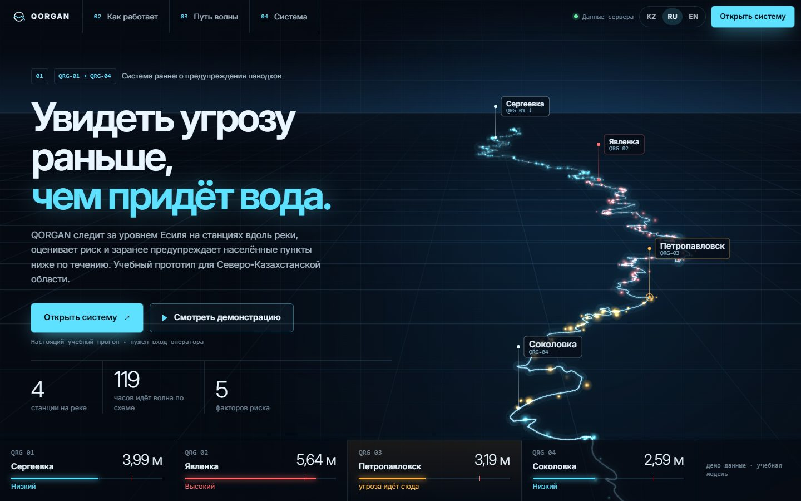

# QORGAN Hydro Future — финальная главная страница

Выбранная концепция **B — HYDRO FUTURE** (анимированная версия) доведена до законченной главной страницы. Концепции A
(River Noir) и C (Editorial Water) отклонены и убраны из интерфейса; их код остался в истории Git (коммит `ad56e5b`).
Ветка `revolution/qorgan-eclipse`, только интерфейс: backend, симулятор, модель риска и Python-датчик не менялись.



## 1. Концепция

Приборная глубина: Есиль уходит к горизонту по перспективной сетке, по руслу течёт поток света, станции стоят на
мачтах с подписями, внизу — приборная полоса с уровнями. Холодный голубой акцент, крупная плотная типографика
(Inter 650), моноширинные подписи, тёмная сцена. Слоган — **«Увидеть угрозу раньше, чем придёт вода»**
(kk: «Су жетпей тұрып, қауіпті ерте көру», en: «See the threat before the water arrives»).

Честность сохранена: всё, что выглядит как измерение, приходит с сервера; иллюстрации подписаны «Схема»; бейдж
«Демо-данные · учебная модель» есть на первом экране и в подвале; пороги — «учебные».

## 2. Структура

| Адрес | Что открывается |
|---|---|
| `http://localhost:3000/` (`#/`, `#/welcome`) | главная Hydro Future |
| `#/concepts`, `#/concepts/a|b|c` (старые ссылки) | перенаправление на `#/` без новой записи в истории |
| `#/dashboard`, `#/outlook`, `#/alerts`, `#/stations`, `#/analytics`, `#/simulator`, `#/admin` | рабочая система Eclipse без изменений; вход — окно входа |

Разделы главной (номер в меню = номер раздела):

1. **01 — Первый экран.** Сцена реки (Canvas), заголовок, «Открыть систему» и «Смотреть демонстрацию», три числа из
   данных (станций в БД, сумма времени добегания, факторов риска), приборная полоса: уровень каждой станции, шкала
   до опасного порога, риск, «угроза идёт сюда».
2. **02 — Как работает.** Связанная схема «Датчик → Анализ → Предупреждение»: рисунок датчика у реки, по пунктиру
   между шагами бежит сигнал (подписано «Схема»). В каждом шаге — значение «Данные сервера»: уровень самой
   тревожной станции (и пометка «датчик MQTT», если показание пришло с Python-датчика), её риск и шкала до учебных
   порогов, первое активное предупреждение с ходом «Новое → Просмотрено → Обработано» или «Активных предупреждений нет».
3. **03 — Путь волны.** Сергеевка → Явленка → Петропавловск → Соколовка на шкале **времени добегания из БД**
   (0, +51, +102, +119 ч). Участок угрозы и «угроза идёт сюда» — из снимка (`riverFlow`). Четыре карточки: где
   угроза сейчас, куда может двигаться, что означает прогноз (диапазон, учебная модель), почему важно раньше.
   Бегущий свет по шкале — иллюстрация направления течения, а не расчёт (подписано). На телефоне шкала вертикальная.
4. **04 — Настоящая система.** Пять вкладок (Карта, Предупреждения, Прогноз, Станции, Симулятор) со **снимками
   экрана настоящего интерфейса** во время учебного прогона «Быстрый паводок» и кнопкой «Открыть этот раздел».
   Снимки — файлы в `apps/web/src/welcome/shots/`, подпись под ними говорит, что это снимки и демо-данные.
5. **05 — Финал.** Слоган, линия Есиля (все фрагменты OSM) с бегущим потоком, две кнопки, подвал с бейджем.

## 3. Как работают кнопки и переходы

- **«Открыть систему»** → `#/dashboard`. Файл рабочей системы подгружается заранее (когда браузер свободен, при
  наведении или фокусе на кнопке), поэтому переход без ожидания.
- **Переход** — перекрёстное затухание View Transitions API (старый кадр слегка приближается и растворяется, новый
  проявляется, ≈ 0,4 с). Если браузер его не умеет или включено «меньше движения» — смена мгновенная.
- **«Назад»** из системы возвращает на главную **на то же место прокрутки**. Логотип в боковом меню системы ведёт на
  главную («На главную»), пункт «Главная панель» — на панель.
- **«Смотреть демонстрацию»** — тот же «Демо за 2 минуты» (`state/demo.tsx`) на настоящей серверной симуляции. Без
  входа открывается окно входа оператора; **после входа демонстрация начинается сама**, второе нажатие не нужно.
  Закрыли окно без входа — ничего не запускается.
- Вход, язык и тема живут выше обеих частей, переход их не сбрасывает.

## 4. Анимационная система

| Где | Что | Как |
|---|---|---|
| Сцена реки | поток ≈ 120–340 частиц со следом, бегущий блик раз в 9 с, кольцо «угроза идёт сюда» | `RiverScene` (Canvas 2D) |
| Заголовок | слова проявляются из размытия | CSS `cine-word` |
| Разделы | плавное появление при прокрутке | IntersectionObserver + CSS |
| Первый экран при прокрутке | текст поднимается и растворяется, сцена отдаляется | CSS scroll-driven animation (`animation-timeline: view()`), без поддержки — эффекта нет |
| «Как работает» | волны у датчика, сигнал датчика, пакет по пунктиру | CSS |
| «Путь волны» | течение по шкале, пунктир угрозы, бегущий свет, кольцо | CSS |
| Кнопки | блик по главной кнопке, подъём | CSS |
| Переход в систему | перекрёстное затухание | View Transitions API |

**Сцена реки (`apps/web/src/welcome/RiverScene.ts`).** Класс без React, всё, что берётся у браузера, — через объект
`FrameHost` (в тестах подменяется):

- один цикл `requestAnimationFrame`; повторные вызовы не создают второй цикл;
- кадр не чаще ≈ 60 раз/с (на мониторах 120–240 Гц сцена не рисуется лишний раз);
- сетка, свечение русла, туман у горизонта рисуются **один раз** в отдельный слой (при изменении размера);
  в кадре — копия слоя, частицы (заранее нарисованные светящиеся спрайты, режим `lighter`) и подписи станций;
- плотность пикселей не выше 2 (на очень большом холсте 1,5), число частиц — по площади, не больше 340;
- цикл останавливается, когда включено «меньше движения» (один законченный кадр), сцена вне экрана
  (IntersectionObserver), вкладка скрыта (`visibilitychange`) или компонент размонтирован (`destroy`);
- русло сглажено (Chaikin) — форма реки и положение станций по координатам из БД не меняются; изгибы в перспективе
  усилены ×2,2 и ось слегка развёрнута — это схема (как в прототипе B);
- цвет участка — состояние связи из снимка: голубой — спокойно, янтарный/красный — угроза идёт вниз.

Бесконечные CSS-анимации раздела идут только пока раздел рядом с экраном (атрибут `data-on`).

**Меньше движения.** По системной настройке `prefers-reduced-motion` страница получает `data-still`: все анимации и
переходы выключены, скрытое до анимации сразу показано, сцена — один статичный кадр с частицами на своих местах,
бегущие огни скрыты. Переключателя анимации в интерфейсе больше нет.

> **Важно для этого ноутбука.** Windows здесь сообщает браузеру «уменьшить движение» (выключены «Эффекты
> анимации»). Поэтому главная будет статичной. Чтобы увидеть анимацию: **Параметры Windows → Специальные
> возможности → Визуальные эффекты → Эффекты анимации — Вкл.**, затем обновить страницу (F5).

## 5. Мобильная версия

Своя компоновка, а не уменьшенный десктоп: заголовок → **река отдельным кадром** (видна уже на первом экране
телефона) → пояснение → кнопки во всю ширину → числа → приборная полоса 2×2. Меню — на весь экран (кнопка «Меню»):
фокус внутри меню, Tab не уходит наружу, Esc закрывает и возвращает фокус, страница под меню не прокручивается.
Шаги «Как работает» — вертикальная цепочка, «Путь волны» — вертикальная шкала, вкладки снимков прокручиваются
вбок, подписи станций на Canvas компактнее.

## 6. Тёмная палитра и темы системы

Главная всегда тёмная: локальные токены `.hf` в `welcome.css`. Пока открыта главная, фон страницы тёмный
(`html:has(.hf)`). Общие имена классов (`.reveal`, `.words`, `.qmark`, `.full-menu`) — **только внутри `.cine`**:
класс `.reveal` есть и в главной панели, без этой изоляции панель после посещения главной становилась
невидимой/размытой (ошибка была ещё в прототипах, исправлена и закрыта тестом). Светлая/тёмная тема системы не
меняется и не перекрашивает главную.

## 7. Производительность (Edge 1440×900, монитор 240 Гц, прогон «Быстрый паводок»)

| Проверка | Результат |
|---|---|
| JS главной при первой загрузке | `index` 201 КБ + `react` 219 КБ + `welcome` 33 КБ + линия реки 30 КБ (≈ 150 КБ gzip); CSS 73 + 26 КБ |
| Раньше (прототипы) | один файл 2 МБ (карта, графики и всё приложение) на любой странице |
| Карта MapLibre и графики | загружаются только при открытии системы |
| CPU (время задач браузера) на первом экране | ≈ 20 % одного ядра (до ограничения 60 кадров/с — ≈ 43 %) |
| CPU, когда сцена вне экрана | ≈ 7 % (было ≈ 18 % до паузы CSS-анимаций вне экрана) |
| 12 переходов «главная ↔ панель» | холст один, число узлов и обработчиков не растёт (6 и 12 переходов — одинаково), память +1 МБ |
| Шрифты | Inter из пакета `@fontsource-variable/inter` (локально), без внешних сервисов — работает без интернета |
| Предупреждение Vite о размере | осталось только для готового файла `maplibre-gl` (1,08 МБ, 294 КБ gzip): его нельзя разделить, он грузится только в системе. Порог не увеличивался (стандартные 500 КБ, раньше был поднят до 2000) |

На слабом ноутбуке не проверялось; на нём сцена сама ограничивает плотность пикселей и число частиц.

## 8. Доступность

Один `h1`, разделы с `h2` и `aria-labelledby`; ссылка «Перейти к содержимому»; видимый фокус (голубая рамка);
кнопки ≥ 44 px на телефоне; сцена Canvas — `aria-hidden` и `pointer-events: none` (не перехватывает нажатия);
заголовок из отдельных слов читается диктором целиком (`aria-label`); вкладки снимков — `tablist`/`tab`/`tabpanel`
со стрелками, Home и End; у снимков — `alt`; статус «Данные сервера / Нет связи» — `role="status"`.

## 9. Источники и лицензии (изучены как приёмы, код не копировался, новых зависимостей нет)

| Источник | Что взято как идея | Лицензия / условия |
|---|---|---|
| motionsites.ai (Velaris, Velia, Freight Scroll, StellarMind) | кинематографичный первый экран, глубина слоёв, рассказ прокруткой. Примеров AI Runtime и AuraMail на сайте нет | платная подписка; исходники и тексты нельзя распространять — только идеи |
| navbar.gallery | полупрозрачная полоса навигации с размытием, которая плотнеет при прокрутке; меню на весь экран | галерея скриншотов, кода и лицензии нет — только идеи |
| ibelick/motion-primitives (TextEffect) | слова из размытия, полный текст для диктора | MIT © 2024 ibelick; зависит от motion + Tailwind — повторено на CSS |
| magicuidesign/magicui (Animated Beam, Retro Grid, Particles) | сигнал между узлами схемы, перспективная сетка | MIT © Magic UI; их Particles использует `Math.random()` и накапливает `scale(dpr)` — не подходит, своя реализация детерминирована |
| motiondivision/motion | — (не установлен: всё нужное делается CSS и rAF) | MIT © 2024 Motion B.V. |
| ui.aceternity.com, hover.dev | только как витрины приёмов | свои лицензии (часть платная), код не брался |
| MDN «Optimizing canvas», Page Visibility API | слой для статичной части, спрайты вместо `shadowBlur` в кадре, `setTransform(dpr)`, пауза при скрытой вкладке | справочная документация |

Данные карты и линии Есиля — © участники OpenStreetMap (ODbL), как и раньше в проекте.

## 10. Ограничения

- Анимация на этом ноутбуке видна только после включения «Эффектов анимации» Windows (см. §4). Сама анимация
  проверена в Edge с эмуляцией «движение разрешено».
- Снимки экрана в разделе 04 — статичные картинки одного момента прогона; при смене интерфейса их нужно переснять
  (скрипт съёмки описан в TESTING.md).
- Названия станций приходят из БД на русском и не переводятся (как во всей системе). Казахские тексты носителем
  языка не проверены.
- Режим «Внешние датчики» показывает «Нет данных» для станций без датчика — так и задумано (данные не выдумываются).
- View Transitions и scroll-driven анимации — в Chromium (Edge/Chrome); в других браузерах переход мгновенный,
  эффекта прокрутки нет.
- Предупреждение Vite про `maplibre-gl` (см. §7). На карте рабочей панели в консоли есть старое предупреждение
  MapLibre «Image "circle-11" could not be loaded» — оно не связано с главной.
- Проверено на одном компьютере (Windows 11, Edge, встроенный браузер Claude). Слабый ноутбук, Firefox, Safari и
  настоящий телефон не проверялись (телефон — эмуляцией 375×812).

## 11. Запуск

```bat
npm install
npm run build
npm start
```

Открыть http://localhost:3000/ — главная. Для разработки: `npm run dev` → http://localhost:5173/. Одним щелчком
с датчиком: `start-demo.bat` (как раньше).

## 12. Проверка (для новичка)

1. Открыть http://localhost:3000/ — первым открывается Hydro Future (тёмная сцена с рекой).
2. Нажать «02 Как работает», «03 Путь волны», «04 Система» вверху — страница плавно переходит к разделу.
3. Нажать KZ / EN / RU — все тексты меняют язык.
4. Нажать «Смотреть демонстрацию» → войти оператором (логин и пароль — в `.env`) → демо начнётся само на панели.
5. Нажать «Назад» в браузере — снова главная, на том же месте.
6. Вернуться на главную, пролистать: в «Как работает» и «Путь волны» появились настоящие уровни, риск и «угроза идёт сюда».
7. В разделе 04 переключить вкладки снимков, нажать «Открыть этот раздел».
8. Сузить окно (или открыть на телефоне): кнопка «Меню», река видна под заголовком.
9. Если анимации нет — включить «Эффекты анимации» Windows (§4) и обновить страницу.

Скриншоты: `docs/screenshots/hydro-future/` — `hero-{1920x1080,1440x900,1366x768,1280x720,768x1024,375x812}.jpg`,
`full-1440.jpg`, `full-375.jpg` (вся страница), `still-1440.jpg` (без движения). Сняты Edge через DevTools Protocol на
тестовой базе worktree, прогон «Быстрый паводок» на паузе в 92-м часе.
